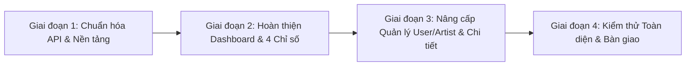

# Lộ trình hoàn thiện AD01: Dashboard và Quản lý Tài khoản Admin (Bản Tối ưu)

## 1. Đối chiếu Phạm vi & Hiện trạng Codebase

Hệ thống đã có sẵn nền tảng vững chắc trong thư mục `frontend/admin` và `backend/admin-service`, `catalog-service`, `api-gateway`:
- **Đã hoàn thiện tốt**: Khung layout chung (`AdminLayout`, `Sidebar`, `Topbar`), Cơ chế xác thực JWT và Interceptor tự động Refresh Token khi gặp mã 401, Routing Admin có `ProtectedRoute`.
- **Phạm vi trọng tâm cần chuẩn hóa (AD01)**:
  1. **Dashboard tổng quan**: 4 chỉ số thống kê chuẩn theo yêu cầu:
     - Tổng người dùng (User)
     - Tổng đối tác nghệ sĩ (Artist)
     - Tổng bài hát trên hệ thống (Catalog Songs)
     - Tổng nội dung đang chờ duyệt (Bài hát + Album PENDING)
  2. **Nội dung mới gửi duyệt gần đây**: Hiển thị danh sách bài hát/album đang chờ duyệt kèm nút điều hướng đến trang kiểm duyệt chi tiết.
  3. **Quản lý danh sách & Chi tiết tài khoản**:
     - Danh sách Người dùng (`/users`) và Nghệ sĩ (`/artists`) có phân trang, lọc tìm kiếm.
     - **Xem chi tiết tài khoản** (Profile Detail Modal) với đầy đủ thông tin nhận diện.
     - **Khóa / Mở khóa tài khoản** an toàn, ngăn chặn admin tự khóa chính mình.
  4. **Khả năng chịu lỗi & Độ tin cậy (Fault Tolerance)**:
     - Số liệu thống kê lấy 100% từ API Backend thực tế; không dùng số liệu giả mạo.
     - Khi một service gặp sự cố hoặc tải chậm, từng card/khối hiển thị trạng thái riêng biệt (Loading Skeleton, Error Indicator), không làm sập toàn bộ trang.

---

## 2. Lộ trình Thực hiện 4 Giai đoạn (Action Plan)

### Giai đoạn 1: Chuẩn hóa API Contract & Tích hợp Nền tảng
- Thống nhất trường trạng thái tài khoản nghiệp vụ: `isActive` (boolean: `true` = hoạt động bình thường, `false` = bị khóa).
- Bổ sung hàm gọi API danh mục công khai `getPublicSongsApi` vào `api/catalog.js` để lấy tổng số bài hát phát hành.
- Kiểm tra tính nhất quán của `api/users.js` và `api/artists.js` với các Feign Clients ở backend `admin-service`.

### Giai đoạn 2: Tối ưu & Chuẩn hóa Dashboard (Trang chủ Admin)
- Cập nhật 4 thẻ chỉ số thống kê chuẩn:
  1. **Tổng người dùng**: Gọi `getUsersApi({ page: 0, size: 1 })` lấy `totalElements`.
  2. **Tổng nghệ sĩ**: Gọi `getArtistsApi({ page: 0, size: 1 })` lấy `totalElements`.
  3. **Tổng bài hát**: Gọi `getPublicSongsApi({ page: 0, size: 1 })` lấy `totalElements`.
  4. **Nội dung chờ duyệt**: Tổng hợp số bài hát chờ duyệt + số album chờ duyệt kèm chú thích chi tiết.
- Cải thiện khối "Nội dung cần duyệt gần đây": hiển thị tên tác phẩm, người gửi, thời gian gửi tương đối, nút duyệt nhanh.
- Thiết lập trạng thái Loading (Skeleton), Error (thông báo lỗi độc lập theo từng card), Empty state trực quan.

### Giai đoạn 3: Nâng cấp Quản lý Tài khoản (User & Artist)
- **Modal xem chi tiết tài khoản**:
  - Tích hợp gọi `getUserDetailApi(id)` và `getArtistDetailApi(id)`.
  - Hiển thị đầy đủ thông tin: Avatar, Họ tên/Nghệ danh, Email, ID định danh, Trạng thái hoạt động, Ngày tham gia, Số người theo dõi (đối với Artist).
- **Thao tác Khóa / Mở khóa an toàn**:
  - Modal xác nhận hành động rõ ràng.
  - Kiểm tra điều kiện an toàn: Vô hiệu hóa nút khóa nếu ID tài khoản trùng với Admin đang đăng nhập.
  - Đồng bộ cập nhật cache dữ liệu bằng `queryClient.invalidateQueries` ngay sau khi cập nhật thành công.

### Giai đoạn 4: Kiểm thử Toàn diện & Nghiệm thu Tiêu chí Bàn giao
- Kiểm tra khả năng xử lý khi Token hết hạn (refresh token mượt mà).
- Kiểm tra lỗi phân quyền 403 (Forbidden) và mất kết nối mạng.
- Đối chiếu toàn bộ 12 tiêu chí bàn giao của AD01.

---

## 3. Checklist Nghiệm thu Bàn giao (AD01 Acceptance Checklist)

- [ ] **1. Dashboard tổng quan**: Giao diện trực quan, chào mừng đúng tên Admin đang đăng nhập.
- [ ] **2. Khung điều hướng chung**: Sidebar và Topbar hoạt động đồng bộ trên máy tính và thiết bị di động.
- [ ] **3. Đủ 4 chỉ số thống kê chuẩn**:
  - [ ] Tổng số User
  - [ ] Tổng số Artist
  - [ ] Tổng số bài hát đã phát hành
  - [ ] Tổng nội dung chờ duyệt (Bài hát + Album)
- [ ] **4. Số liệu thực tế 100%**: Tuyệt đối không hardcode số liệu thống kê; phản ánh đúng kết quả từ Backend.
- [ ] **5. Danh sách nội dung chờ duyệt gần đây**: Hiển thị tác phẩm đang chờ xử lý và nút điều hướng tới trang kiểm duyệt tương ứng.
- [ ] **6. Thông tin phiên đăng nhập**: Hiển thị tên, email hoặc vai trò quản trị viên trên Header/Sidebar.
- [ ] **7. Xử lý trạng thái giao diện**: Có Skeleton loading khi tải dữ liệu, thông báo khi rỗng hoặc khi API lỗi.
- [ ] **8. Trang danh sách Người dùng**: Có bảng danh sách, phân trang, tìm kiếm.
- [ ] **9. Trang danh sách Nghệ sĩ**: Có bảng danh sách, phân trang, số người theo dõi.
- [ ] **10. Xem chi tiết tài khoản**: Có Modal/Drawer xem thông tin chi tiết của User và Artist.
- [ ] **11. Khóa / Mở khóa tài khoản**: Thao tác cập nhật trạng thái hoạt động với backend thành công và có phản hồi Toast rõ ràng.
- [ ] **12. An toàn tài khoản**: Không cho phép Admin tự khóa tài khoản của chính mình.
